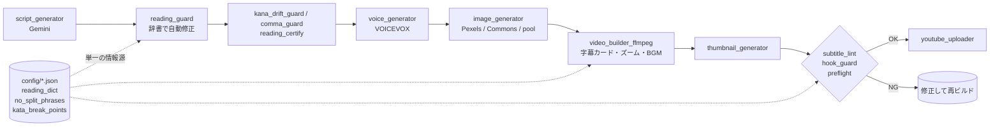

# shorts-pipeline

日本語 YouTube Shorts（縦型）と長尺動画を、台本生成から投稿まで無人で回すパイプラインです。実運用では 5 チャンネルで 1 日 12〜18 本を処理しています。このリポジトリは運用中のコードから、公開できない部分（認証情報・チャンネル固有の値・運用ログ・素材）を除いたものです。

AI 駆動開発の実例として、次の 2 点を見てもらうことを想定しています。

1. 生成物の品質を、LLM の出力に頼らず**コードと辞書で保証する**構造（下記「品質ガード」）
2. Claude Code を設計・実装・運用の相手として使い続けた方法（下記「Claude Code の使い方」）

姉妹リポジトリ: 品質ガードのうち字幕の改行検査を切り出したもの → https://github.com/rei0731/subtitle-guard

## 何をするか

```
台本生成 → 読み検査 → 音声(VOICEVOX) → 画像 → 動画(FFmpeg) → サムネ → 投稿前検査 → YouTube投稿
```

| 工程 | 内容 | 主なモジュール |
|---|---|---|
| 台本 | Gemini で題材選定・台本・かな読み（narration_kana）を JSON で生成。重複題材・禁止題材を除外 | `script_generator.py` |
| 読み検査 | 漢字→かなの誤読を辞書と形態素解析で検出・自動修正 | `reading_guard.py` `reading_certify.py` `kana_drift_guard.py` |
| 音声 | VOICEVOX Engine で合成。助詞「は」「へ」の読み保証、読点の間引き | `voice_generator.py` `particle_wa.py` `comma_guard.py` |
| 画像 | カード（テロップ 1 枚）ごとに 1 画像。Pexels / Wikimedia Commons / 共有画像プール | `image_generator.py` `image_sources.py` `image_pool.py` |
| 動画 | FFmpeg で字幕カード分割・2 行バランス・ズーム/パン・SE/BGM ミックス | `video_builder_ffmpeg.py` |
| サムネ | 見出し抽出と改行、フォント描画 | `thumbnail_generator.py` |
| 検査 | 字幕改行の独立リンター、冒頭フック切れ検査 | `subtitle_lint.py` `hook_guard.py` |
| 投稿 | OAuth で YouTube Data API へ。1 日の投稿上限・説明欄長のガード付き | `youtube_uploader.py` |
| 分析 | 再生数・コメント等を取得して次の題材選びへ反映 | `channel_analyzer.py` |

## アーキテクチャ



`main.py` が上の流れを 1 本にまとめ、`CHANNEL_TYPE` でチャンネル別の題材・文体・画像スタイルを切り替えます（`config/settings.example.py`）。

## 品質ガードの設計

動画生成で一番やっかいなのは、**エラーも出ずに動いているのに、中身が間違っている**ことです。

- TTS が「方角」を誤って読んでも、ファイルは正常に出力される
- 字幕が「口裂け｜女」の位置で改行されても、FFmpeg は何も言わない
- どちらも投稿後に視聴者に指摘されて初めて分かる

個別の事故ごとにパッチを当てると、同じ種類の事故が別の経路で再発します。そこで 3 層に分けました。

1. **辞書が唯一の情報源**: `config/reading_dict.json`（誤読語→正しい読み）、`no_split_phrases.json`（改行で分断してはいけない語）、`kata_break_points.json`（長いカタカナ語の切れ目）。事故が起きたらここに 1 行足すだけで、全系統に効く
2. **独立リンター**: `subtitle_lint.py` は、改行エンジン（`video_builder_ffmpeg.py`）の結果を、エンジンとは別のルールで検査する。エンジンの実装を信用せず、出力だけを見る。同じ辞書を読むので、辞書の追記は両方に効く
3. **生成時ガード**: `reading_guard.py` `comma_guard.py` `kana_drift_guard.py` `particle_wa.py` は台本・音声の生成中に呼ばれ、NG を投稿前に止める。`reading_certify.py` は、VOICEVOX 自身が返す読み（アクセント句）と台本のかなを突き合わせて、辞書にない誤読も拾う

`tests/` には、外部サービスを使わない純関数のテスト（辞書の自動修正、読点なし区間の検出、字幕リンターの判定）を置いています。

```bash
pip install -r requirements.txt
python -m pytest -q      # 外部サービス不要。config/settings.example.py を自動で使う
```

## Claude Code の使い方

このコードの大部分は Claude Code と対話しながら作り、同じ方法で運用しています。

- **CLAUDE.md**: リポジトリに置く作業前提。鉄則（過去事故の再発防止）、知識の置き場所、表記ルールを短く書く。長くなるほど守られにくいので、行数に上限を決めて運用
- **スキル**: 手順書や、特定の作業にしか要らない知識は CLAUDE.md に書かず、スキルに分ける。例: 漢字の読み知識ベース、字幕改行の調整手順、品質ガードの運用手順、画像切替の仕組み
- **メモリ（チームの知識）**: 事故の経緯、採用しなかった案とその理由、ユーザーの判断を蓄積し、次のセッションが同じ失敗をしないようにする。コードのコメントにも日付つきで「なぜそうしたか」を残している
- **検証を省かない**: 生成物は実体で確認する（投稿後の実体確認、投稿前の preflight）。「できたはず」で報告しない
- **作業の振り分け**: 広い調査は別エージェントに任せ、結論だけ受け取る。定型作業は軽いモデル、設計判断と最終確認は上位モデルで行い、軽いモデルの成果も実体で検証してから採用する

## モジュール一覧

| ファイル | 行数 | 役割 |
|---|---:|---|
| `src/main.py` | 330 | 全工程を通すエントリポイント |
| `src/script_generator.py` | 781 | Gemini で台本・かなを生成。題材の重複・禁止題材の除外 |
| `src/voice_generator.py` | 739 | VOICEVOX 合成。かな修正、助詞読み保証、長音補正 |
| `src/video_builder_ffmpeg.py` | 2609 | FFmpeg による動画合成。字幕カード分割・改行・演出 |
| `src/video_builder.py` | 435 | 旧経路（moviepy） |
| `src/thumbnail_generator.py` | 577 | サムネ見出しの抽出・改行・描画 |
| `src/image_generator.py` | 352 | 画像取得（Pexels 等）とプロンプト生成 |
| `src/image_sources.py` | 193 | Wikimedia Commons から実物写真とライセンス情報を取得 |
| `src/image_pool.py` | 138 | 取得済み画像の再利用プール |
| `src/youtube_uploader.py` | 348 | OAuth・アップロード・投稿上限・説明欄ガード |
| `src/channel_analyzer.py` | 185 | チャンネル分析（Data / Analytics API） |
| `src/reading_guard.py` | 320 | 辞書による誤読の検出・自動修正、数字の読み検査 |
| `src/reading_certify.py` | 480 | VOICEVOX の読みと台本かなの突き合わせ（認証） |
| `src/kana_drift_guard.py` | 172 | 台本かなが本文からずれていないかの検査 |
| `src/particle_wa.py` | 204 | 助詞「は」を「わ」と読ませる処理 |
| `src/comma_guard.py` | 214 | 読点なしで長く続くかな列の検出・読点挿入 |
| `src/subtitle_lint.py` | 281 | 字幕改行の独立リンター |
| `src/hook_guard.py` | 41 | 冒頭フック・サムネ見出しの途中切れ検査 |
| `src/sleep_meta.py` | 52 | 睡眠用ロングの題・説明・タグ |
| `src/notify.py` | 119 | 完了通知（現在は無効化） |
| `config/settings.example.py` | 約340 | 設定サンプル（値はすべて環境変数/プレースホルダ） |
| `config/*.json` | - | 辞書 3 種（読み・分断禁止語・カタカナ切れ目） |
| `tests/` | - | pytest（読み・読点・字幕リンターの純関数） |

## このリポジトリに含めていないもの

- **認証情報すべて**: OAuth クライアント、トークン、API キー、Notion/Gmail 連携。`config/settings.example.py` は環境変数から読む形
- **運用スクリプト群**: 日次投稿・再ビルド・一括修正などの個別スクリプト（チャンネル固有の ID・パスが多く、公開向きでないため）
- **ログ・履歴・生成物・素材**: 動画、音声、画像、BGM、効果音、フォント（権利と容量の理由）
- **運用ドキュメント**: 引き継ぎ・レポート類（実名やチャンネル固有の情報を含むため）
- **一部のモジュールが参照する未収録ファイル**: `preflight_check.py`（投稿前検査の統合スクリプト）、`build_image_pool.py`、`gfile`（`notify.py` の任意機能）。import 先として残してありますが、このリポジトリ単体では該当経路は動きません
- チャンネル名は `channel A`〜`E` と一般化しています。`CHANNEL_TYPE` の値や題材ジャンルの語（都市伝説・雑学など）は、コードの挙動に使われるためそのまま残しています

## 動かすには

1. FFmpeg を PATH に通し、VOICEVOX Engine を起動（既定 `http://127.0.0.1:50021`）
2. `config/settings.example.py` を `config/settings.py` にコピーし、`config/.env` に `GEMINI_API_KEY` などを設定
3. `python -m src.main`（`--long` でロング動画）

実運用の環境（Windows + スケジューラ）に合わせた作りなので、他環境ではパスやフォント等の調整が要ります。

## ライセンス

MIT
